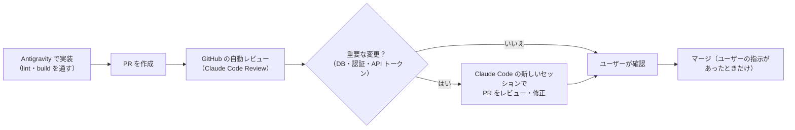

# Antigravity 向け引き継ぎメモ（Study 統合）

> Claude Code（レビュー・修正担当）から、Antigravity（実装担当）への引き継ぎメモです。
> 実装を始める前にこのファイルを読み、設計の全体像は [study-integration-design.md](./study-integration-design.md)、手順は [study-integration-workflow.md](./study-integration-workflow.md) を参照してください。
> 最終更新: 2026-11-27（Step 5 完了時点）

---

## 1. 現在地

| Step | 内容 | 状態 |
| :--- | :--- | :--- |
| Step 0 | 設計書・ワークフローを `main` に取り込み | ✅ マージ済み（PR #26） |
| Step 1 | DB マイグレーションと `src/types/study.ts` | ✅ マージ済み（PR #27）、**本番 DB にも適用済み** |
| （追加） | `rls_auto_enable()` の EXECUTE 権限削除 | ✅ マージ済み（PR #29）、本番 DB にも適用済み |
| Step 2 | 認証基盤（Service Role・2レーン認証・Middleware の例外設定） | ✅ マージ済み（PR #32） |
| Step 3 | API トークン管理エンドポイント（GET/POST/DELETE） | ✅ マージ済み（PR #33）、本番で動作確認済み |
| Step 4 | `/settings` の API トークン管理 UI | ✅ マージ済み（PR #34） |
| Step 5 | Vitest 導入と純粋ロジック（`geo` / `time` / `weather` / `admin-validation`）の移植 | ✅ マージ済み（PR #35） |
| **Step 6** | Study サービス層の移植（`userId` スコープ化） | ⏭ **次はここから** |

- Step 6 のブランチ名は `feat/study-06-study-services` です。最新の `main` から切ってください。
- Supabase の本番プロジェクトは **`LifeOS`（ref: `yrrtrgedefzlkeqfcjyj`）** です。同じ組織にある `ypt-for-me` は移行元なので、触らないでください。

---

## 2. 本番 DB の状態（Step 1 適用後）

すべて `public` スキーマにあり、RLS が有効で、ポリシーの条件は `(select auth.uid()) = user_id` です。

| テーブル | `authenticated`（ログインユーザー）に許可していること | 備考 |
| :--- | :--- | :--- |
| `api_tokens` | **SELECT（`token_hash` 以外の列のみ）と DELETE だけ** | INSERT と UPDATE は `service_role` のみ |
| `study_settings` | 自分の行に対して全操作 | `updated_at` はトリガーで自動更新 |
| `study_categories` | 自分の行に対して全操作 | `(user_id, name)` がユニーク |
| `study_spots` | 自分の行に対して全操作 | `(user_id, name)` がユニーク |
| `study_sessions` | 自分の行に対して全操作 | Realtime publication に追加済み |

- `anon`（ログインしていない状態）には、どのテーブルにも権限がありません。
- `goals.id`、`projects.id`、`tasks.id` が `uuid` 型であることは確認済みです。`study_sessions` の外部キーは `ON DELETE SET NULL` です。

---

## 3. Step 2〜4 で必ず守ること（`api_tokens` まわり）

Step 1 のレビューで、`api_tokens` の権限を設計書の初版より**絞りました**。設計書とワークフローも更新済みですが、実装時に一番つまずきやすい点なので、ここにまとめます。

1. **トークンの発行（INSERT）は Service Role のクライアントで行う。**
   - `POST /api/settings/tokens` の流れ：Cookie セッションでユーザーを確認する → ランダムなトークンを生成する → SHA-256 ハッシュを計算する → **admin クライアントで** INSERT する（`user_id` はサーバーが確認したユーザーの ID）。
   - 通常のサーバークライアント（`src/utils/supabase/server.ts`）で INSERT すると、`permission denied` になります。
2. **Bearer トークンの照合と `last_used_at` の更新も、Service Role で行う。**
   - `resolveStudyAuth()` は、`token_hash` の一致と `revoked_at IS NULL` で照合します。
3. **`token_hash` をクライアントに返さない。**
   - `authenticated` では、`token_hash` を SELECT できないようにしてあります。`select('*')` は**エラーになる**ので、列を明示してください。
   - 列の指定例：`id, name, token_prefix, scopes, last_used_at, revoked_at, created_at`
   - 型は `ApiTokenSummary` を使ってください（`src/types/study.ts`）。
4. **失効は「行の削除」で行う。**
   - `authenticated` に許可しているのは DELETE だけです。`revoked_at` を設定して記録を残したい場合は、Service Role で UPDATE してください。
5. **Service Role のキーの扱い**
   - 現在の `.env.local` にはまだありません。ローカルの `.env.local` と Vercel の環境変数の両方に追加が必要です。
   - 変数名は設計書どおり `SUPABASE_SERVICE_ROLE_KEY` にしてください。**`NEXT_PUBLIC_` は絶対に付けないでください**（付けるとブラウザに漏れます）。
   - Supabase の新しい API キー方式を使う場合は、Secret key（`sb_secret_...`）がこれにあたります。
   - `src/utils/supabase/admin.ts` の先頭に `import 'server-only'` を書き、クライアントコンポーネントから読み込めないようにしてください。

---

## 4. Study テーブルを扱う API・ロジックの注意点（Step 5 以降）

- **他のユーザーの ID を参照できてしまう問題**
  RLS は `user_id` しか見ていません。そのため、`category_id`、`spot_id`、`goal_id`、`project_id`、`task_id` に**他のユーザーの行の ID** を入れても、INSERT や UPDATE が通ってしまいます。
  API 側で、**参照先が同じユーザーのものか必ず確認してください**（例：`study_categories` を `id` と `user_id` で SELECT して、存在するか確認する）。
- **進行中のセッションは1ユーザー1つまで**
  `study_sessions_single_active_idx` で保証しています。2つ目を開始するとユニーク制約違反（`23505`）になるので、API では 409 などに変換してください。
- **二重送信の防止（冪等性）**
  `(user_id, start_event_id)` と `(user_id, stop_event_id)` がユニークです。オフライン同期で同じイベントが再送されたときは、`23505` を「処理済み」として扱えます。
- **カテゴリの削除**
  セッションから参照されているカテゴリは、DB が削除を拒否します（`23503`）。UI では「アーカイブ（`is_archived`）」を案内してください。
- **`study_settings.univ_periods`**
  jsonb で、DB 側では形を検証していません。読み込むときにパースして検証してください。デフォルト値は SQL と `DEFAULT_UNIV_PERIODS`（TS）の二重管理なので、変更するときは両方を直してください。
- **`duration_sec`**
  `ended_at - started_at` との整合性を、DB はチェックしていません。セッションを終了するときに、サーバー側で計算してください。
- **Realtime の DELETE イベント**
  DELETE イベントには主キーしか含まれません（`replica identity` がデフォルトのため）。クライアント側では、`id` で該当の行を消す実装にしてください。

---

## 5. DB マイグレーションの運用

- マイグレーションファイルは `supabase/migrations/` に置きます。今回の2本は、**Claude Code が Supabase MCP 経由で本番に適用**しました。
- **注意：リポジトリのファイル名と、Supabase 側の履歴のバージョン番号が一致していません。**

  | リポジトリのファイル | Supabase 側の履歴 |
  | :--- | :--- |
  | `20261127134700_create_study_and_api_tokens.sql` | `20261127062008` |
  | `20261127153000_revoke_rls_auto_enable_execute.sql` | `20261127062137` |

  そのため、**`supabase db push` は使わないでください**（同じマイグレーションを二重に適用しようとします）。今後も、適用は Claude Code に頼むか、SQL Editor から手動で行ってください。古い `add_rls_policies.sql` などは、手動で適用されたものです。
- 本番 DB には、`ensure_rls` というイベントトリガーがあります。`public` に作ったテーブルは、**RLS が自動で有効になります**。ポリシーを書き忘れると、誰も読み書きできないテーブルになるので注意してください。
- Supabase は、新しいテーブルに対して `anon` にも全権限を自動で付けます。新しいテーブルを作るときは、`revoke all on table ... from anon;` を明示してください（Step 1 のマイグレーションを参考にしてください）。

---

## 6. 開発フロー（Antigravity と Claude Code の使い分け）

- **自動レビュー**：PR の作成時と push のたびに、GitHub Actions の `Claude Code Review` が動きます（`.github/workflows/claude-code-review.yml`）。
- **`@claude`**：PR のコメントに `@claude 〜して` と書くと、GitHub 上で Claude が対応します（`.github/workflows/claude.yml`）。
- **マージ**：ユーザーの明示的な指示があるときだけ行います。
- PR の説明には、ワークフローの規約どおり「変更内容」「確認手順」「設計書との対応箇所」を書いてください。

---

## 7. 別 PR で対応する残タスク

レビューで見つかったものの、該当 Step のスコープ外として後回しにしたものです。対応したらこの表から消してください。

| 内容 | 理由 / メモ |
| :--- | :--- |
| GitHub Actions で `npm test`（Vitest）を PR ごとに実行する | 現在の CI は `claude-review` と Vercel ビルドのみで、単体テストはローカルでしか走らない。`npm ci` → `npm test` だけの軽いワークフローでよい。ブランチ名例: `chore/ci-vitest` |

---

## 8. 環境・運用メモ

- **Vercel Preview**：`NEXT_PUBLIC_SUPABASE_URL` / `NEXT_PUBLIC_SUPABASE_PUBLISHABLE_KEY` / `SUPABASE_SERVICE_ROLE_KEY` は Production と Preview の両方に設定済み。Preview も**本番と同じ Supabase（`LifeOS`）**に繋がるため、Preview で作ったテストデータは確認後に削除すること。
- **Preview でのログイン**：パスキーはドメインに紐づくため Preview では使えない。メールのログインリンクを使う（Supabase の Redirect URLs に `https://lifeos-*-sora0311.vercel.app/**` を追加済み）。
- **祝日判定（`src/lib/study/time.ts`）**：2020 年以降のみ対応。Study の利用開始は 2026 年なので、移行データも含めて範囲内。祝日法が改正されたら `getJapaneseHolidaysForYear()` とテストを更新すること。

---

## 9. その他

- **Next.js 16**：`AGENTS.md` にあるとおり、学習データとは API が違う箇所があります。実装の前に `node_modules/next/dist/docs/` を確認してください（middleware の書き方も含みます）。
- **リポジトリ名の変更**：旧名 `Personal-Dashboard` から **`LifeOS`** に変わりました。ローカルの `origin` も `https://github.com/sora-0311-1131/LifeOS.git` に更新済みです。
- **Supabase Security Advisor**：残っている警告は「漏洩パスワード保護が無効」の1件だけです。ダッシュボードの Auth 設定でオンにできます。
