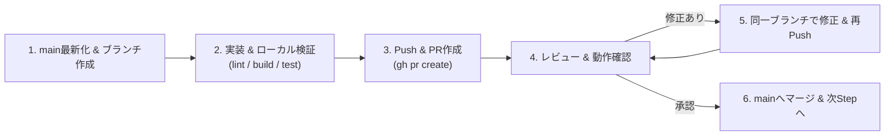

# YPT-for-me → LifeOS 統合ワークフロー

[study-integration-design.md](./study-integration-design.md) の設計方針に基づき、**1ステップ = 1ブランチ = 1 PR** で段階的に統合を進めるための細分化ワークフローです。

- **移行元リポジトリ（YPT-for-me）**:
  - ローカル: `/home/sora0311/dev/YPT-for-me`
  - GitHub: https://github.com/sora-0311-1131/YPT-for-me

---

## 進行ルール（全ステップ共通）

各ステップは以下のサイクルで進めます。

- **ブランチ命名規則**: `feat/study-XX-<slug>`（例: `feat/study-01-db-migration`）
- **PR ベース**: 常に最新の `main`（前ステップのマージ完了後に次ステップのブランチを切る）
- **PR 作成時の必須チェック**:
  - `npm run lint` / `npm run build` が通ること
  - Step 5 以降は `npm test`（Vitest）が全パスすること
  - PR 説明に「変更内容」「確認手順」「設計書との対応箇所」を記載すること

---

## 全体ロードマップ（全 17 ステップ）

| Phase | Steps | ゴール | 進捗 |
| :--- | :--- | :--- | :---: |
| **準備** | Step 0 | 設計書・ワークフローを `main` に取り込みベースラインを整理 | [ ] |
| **Phase 1：DB & 認証基盤** | Step 1 〜 4 | テーブル・RLS 構築、Bearer / Cookie 2レーン認証、`/settings` での API トークン発行・失効 | [ ] |
| **Phase 2：ロジック・API・移行** | Step 5 〜 9 | Vitest 導入、ロジック＆API 完全移植、NFC 打刻疎通、既存データ移行スクリプト | [ ] |
| **Phase 3：`/study` UI & トップ統合** | Step 10 〜 14 | `/study` 全4タブ＋LT マスク＋Realtime 同期、トップ `/` の「Study Today」カード、サイドバー有効化 | [ ] |
| **Phase 4：Plan × Actual 連携** | Step 15 〜 16 | Tasks / Projects からのワンクリック計測＆累計時間表示、Period / Goal / Project 別集計 | [ ] |

---

## ステップ詳細

### 準備

#### Step 0: 設計ドキュメント・ワークフローのコミット
- **ブランチ**: `docs/study-integration-docs`
- **内容**:
  - `docs/study-integration-design.md` と `docs/study-integration-workflow.md` をコミット。
- **完了条件**: `main` の作業ツリーがクリーンな状態で Phase 1 に入れる。

---

### Phase 1：DB & 認証基盤

#### Step 1: DB マイグレーション & Study 型定義
- **ブランチ**: `feat/study-01-db-migration`
- **内容**:
  - `supabase/migrations/` に新規マイグレーション SQL を作成：
    - `public.api_tokens`
    - `public.study_settings`
    - `public.study_categories`
    - `public.study_spots`
    - `public.study_sessions`（`goal_id` / `project_id` / `task_id` の `ON DELETE SET NULL` 外部キー、単一アクティブ制約、冪等性制約、各種インデックス）
    - 全テーブルの `GRANT`・`RLS`（`auth.uid() = user_id`）・`study_sessions` の Realtime publication 設定
  - `src/types/study.ts` に DB テーブルに対応する TypeScript 型定義を追加。
- **検証**: SQL 構文・制約チェック、LifeOS Supabase への適用確認、`npm run build` パス。

#### Step 2: 認証基盤（Service Role・2レーン認証・Middleware 例外）
- **ブランチ**: `feat/study-02-auth-foundation`
- **内容**:
  - `src/utils/supabase/admin.ts`（`SUPABASE_SERVICE_ROLE_KEY` を使うサーバー専用クライアント）を作成。
  - `src/lib/study/auth.ts` に `resolveStudyAuth(request)` を実装：
    - `Authorization: Bearer <token>` がある場合は SHA-256 ハッシュで `api_tokens` を照合（`revoked_at IS NULL`）し `userId` を解決＋`last_used_at` を更新。
    - Bearer がない場合は Cookie の Supabase Auth（`supabase.auth.getUser()`）で `userId` を解決。
    - 未認証時は `401 Unauthorized` JSON を返すヘルパーを提供。
  - `src/utils/supabase/middleware.ts` を更新し、`/api/study/` および `/api/settings/tokens` を `/login` リダイレクト対象から除外。
- **検証**: 未認証での `/api/study/*` アクセスがリダイレクトされず 401 JSON を返すこと、`npm run build` パス。

#### Step 3: API トークン管理エンドポイント実装
- **ブランチ**: `feat/study-03-api-tokens-api`
- **内容**:
  - `src/app/api/settings/tokens/route.ts`：
    - `GET`: ログインユーザーの発行済みトークン一覧取得（`token_hash` は返却しない）。
    - `POST`: `lifeos_` プレフィックス付きの安全なランダムトークン生成 → SHA-256 ハッシュのみ保存 → 生トークンを初回レスポンスで 1 度だけ返却。
  - `src/app/api/settings/tokens/[id]/route.ts`：
    - `DELETE`: トークンの失効（`revoked_at` 設定または削除）。
- **検証**: ブラウザセッションで発行・一覧取得・失効ができ、失効済みトークンで `resolveStudyAuth` が 401 になること。

#### Step 4: `/settings` に API トークン管理 UI を追加
- **ブランチ**: `feat/study-04-settings-token-ui`
- **内容**:
  - `src/components/settings/ApiTokenManager.tsx` を作成し、`src/app/settings/page.tsx` のパスキー管理セクションの下に組み込む。
  - トークン名入力 → 発行 → 生成トークンの 1 回限り表示＆コピー UI。
  - 発行済み一覧（名前・プレフィックス・作成日・最終利用日・失効/削除ボタン）。
- **検証**: `/settings` 画面でトークン発行・コピー・リロード後の一覧表示・失効が一通り動作すること。

---

### Phase 2：Study ロジック・API・データ移行

#### Step 5: Vitest 導入 & 純粋ロジック移植（`geo`, `time`, `weather`, `validation`）
- **ブランチ**: `feat/study-05-core-logic-and-tests`
- **内容**:
  - LifeOS に `vitest` を導入し、`vitest.config.ts` と `package.json` の `test` スクリプトを追加。
  - YPT-for-me から `geo.ts`, `time.ts`, `weather.ts`, `admin-validation.ts` を `src/lib/study/` に移植。
  - 対応する単体テストを移植。
- **検証**: `npm test` 全パス、`npm run lint` / `npm run build` パス。

#### Step 6: Study サービス層移植（`userId` スコープ化）
- **ブランチ**: `feat/study-06-study-services`
- **内容**:
  - YPT-for-me から `study-service.ts`, `study-sync.ts`, `dashboard-service.ts`, `analytics-service.ts` を `src/lib/study/` に移植。
  - 全関数を `userId: string` 明示引数＋`study_*` テーブル参照へ変更（公開 DTO / `AdminSessionDto` の二重構造を廃止し単一モデルに整理）。
  - `start` 時に任意の `goal_id`, `project_id`, `task_id` を受け付けられるように拡張。
  - サービステストを移植・更新。
- **検証**: `npm test` 全パス、`npm run build` パス。

#### Step 7: 打刻・同期 API エンドポイント実装（NFC / ブラウザ両対応）
- **ブランチ**: `feat/study-07-punch-sync-api`
- **内容**:
  - 以下の Route Handlers を実装（すべて `resolveStudyAuth` で Bearer / Cookie 両対応）：
    - `GET /api/study/status`
    - `POST /api/study/start`
    - `POST /api/study/stop`
    - `POST /api/study/toggle`
    - `POST /api/study/sync`
- **検証**: Bearer トークン（`curl` 等）およびブラウザ Cookie の両方で start / status / stop / toggle / sync（冪等性含む）が動作すること。

#### Step 8: ダッシュボード・分析・管理 CRUD API 実装
- **ブランチ**: `feat/study-08-crud-analytics-api`
- **内容**:
  - 以下の Route Handlers を実装：
    - `GET /api/study/dashboard`
    - `GET /api/study/analytics`
    - `GET/POST /api/study/sessions`, `PATCH/DELETE /api/study/sessions/[id]`
    - `GET/POST/PATCH/DELETE /api/study/categories`
    - `GET/POST/PATCH/DELETE /api/study/spots`, `POST /api/study/spots/[id]/reapply`
    - `GET/PATCH /api/study/settings`
- **検証**: 各エンドポイントの正常系・バリデーションエラー・未認証 401 の動作確認、`npm run build` パス。

#### Step 9: 既存 YPT データ移行スクリプト & 突合検証ツール
- **ブランチ**: `feat/study-09-data-migration-script`
- **内容**:
  - `scripts/migrate-ypt/` に移行スクリプトと突合検証スクリプトを作成：
    - 旧 YPT Supabase から全テーブル取得 → `study_settings` → `study_categories` → `study_spots` → `study_sessions` の順で UUID 維持・`user_id` 付与・`ON CONFLICT (id) DO NOTHING` で冪等投入。
    - テーブル件数・`duration_sec` 合計・最新セッション日時の突合検証スクリプト。
- **検証**: ドライラン / テスト移行で冪等性（2回実行しても重複しないこと）と突合一致を確認。

---

### Phase 3：`/study` UI & トップ統合

#### Step 10: `/study` シェル・Sidebar 有効化・LT マスク・Realtime 購読
- **ブランチ**: `feat/study-10-study-shell-realtime`
- **内容**:
  - `src/components/layout/Sidebar.tsx` の `Study` (`/study`) から `comingSoon: true` を削除。
  - `src/app/study/page.tsx` に 4 タブ（Overview / History / Analytics / Manage）のシェルを構築。
  - 右上に「LT マスク（自宅座標・Wi-Fi SSID・メモを非表示）」トグルとタイマー拡大ボタンを配置。
  - `study_sessions` を `authenticated` RLS 下で Realtime 購読するカスタムフックを作成（NFC 打刻時の即時同期）。
- **検証**: `/study` 遷移・タブ切替・LT マスクトグル・Realtime 接続がエラーなく動作すること。

#### Step 11: `/study` Overview タブ実装
- **ブランチ**: `feat/study-11-study-overview-tab`
- **内容**:
  - リアルタイムカウントタイマー（稼働中表示・拡大モーダル連携）。
  - KPI カード（今日・今週・Streak・Daily Goal 進捗バー）。
  - 科目別内訳グラフ / リスト。
  - 手動 Start / Stop コントロール（カテゴリ選択＋任意で Project / Task を紐付け可能）。
- **検証**: ブラウザからの Start / Stop、NFC 打刻時のリアルタイム反映、リロード時の状態維持を確認。

#### Step 12: `/study` History タブ実装
- **ブランチ**: `feat/study-12-study-history-tab`
- **内容**:
  - セッション履歴一覧（LT マスク有効時は座標・SSID・メモをマスク表示）。
  - 要確認（`needs_review`）フィルタ＆補正アクション。
  - セッションのインライン編集・削除・手動追加。
  - **Project / Task / Goal への事後紐付け UI**（Layer 2 バインディング）。
- **検証**: フィルタ、編集・削除、事後紐付けの保存・再読込、LT マスクの効きを確認。

#### Step 13: `/study` Analytics タブ実装
- **ブランチ**: `feat/study-13-study-analytics-tab`
- **内容**:
  - 草カレンダー（日別ヒートマップ）。
  - 曜日 × 時間帯ヒートマップ。
  - 大学時限別・スポット別・天気 / 気圧差別の集計ビュー（LT マスク対応）。
- **検証**: 実データ（移行データ）で各種チャート・集計値が崩れず表示されること。

#### Step 14: `/study` Manage タブ & トップ `/`「Study Today」カード実装
- **ブランチ**: `feat/study-14-manage-tab-and-home-card`
- **内容**:
  - Manage タブ：
    - カテゴリ管理（作成・色・並び順・アーカイブ）。
    - スポット管理（作成・編集・削除・未登録座標 / 未登録 Wi-Fi SSID からの逆引き登録＆過去ログ一括再判定 `reapply`）。
    - Study 設定（`day_boundary_hour`, `streak_min_minutes`, 平日/休日目標、長時間警告、`univ_periods`）。
  - LifeOS トップ（`src/app/page.tsx`）に **「Study Today」カード**を追加：
    - 計測中タイマー（稼働中リアルタイム表示＋ワンクリック停止）。
    - 今日の累計時間 / Daily Goal 進捗バー / Streak 日数。
    - `/study` へのリンク。
- **検証**: Manage の全操作、トップページでの計測中表示・停止操作を確認。

---

### Phase 4：Plan × Actual クロス連携

#### Step 15: Tasks / Projects からのタイマー起動 & 累計学習時間バッジ
- **ブランチ**: `feat/study-15-task-project-timer`
- **内容**:
  - Task / Project の一覧・詳細コンポーネントに「累計学習時間バッジ」と「Play（タイマー開始）」ボタンを追加。
  - Play 押下時に対応する `task_id` / `project_id` / `goal_id` を自動付与して計測開始（カテゴリ選択ダイアログまたは既定カテゴリで即開始）。
- **検証**: `/tasks`・`/projects/[id]` から計測開始でき、`study_sessions` に正しく紐付き、累計時間バッジに反映されること。

#### Step 16: Period / Goal / Project 別学習時間の動的集計 & Analytics 統合
- **ブランチ**: `feat/study-16-period-goal-analytics`
- **内容**:
  - `started_at`（`day_boundary_hour` を考慮した論理日付）と `periods.start_date` 〜 `end_date` の範囲から Period 別学習時間を動的導出する集計 API / ロジックを追加。
  - `/study` の Analytics タブに **Period / Goal / Project 別学習時間**セクションを追加。
  - `/periods`・`/goals` 画面にも実績学習時間のサマリーを表示。
- **検証**: Period の期間変更に追従して集計が動的に変わること、Goal / Project 別の実績が正確であること。
